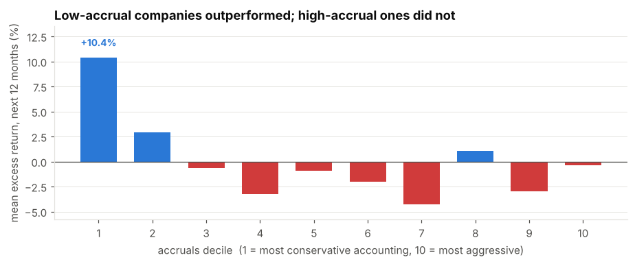
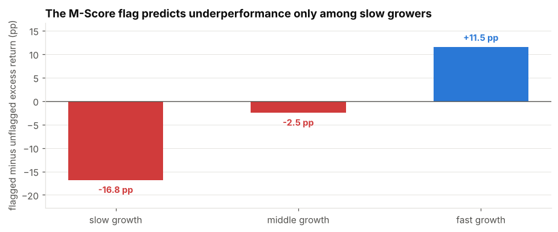

# 10-K Red Flag Detector

**A forensic accounting screener built on SEC filing data — and an honest test of whether it works.**

Pulls every number 309 S&P 500 companies have tagged in their 10-K filings since 2007,
computes the academic earnings-manipulation signals, and checks them against what the
share price actually did next.

---

## Key findings

**1. Sloan's accrual signal works.** Companies in the top quintile of accruals
underperformed the bottom quintile by **8.5 percentage points** over the following 12
months (p = 0.0012), sector- and year-neutral, holding in **14 of 17 years**. Profit
that never becomes cash is a real warning.



**2. The Beneish M-Score does not — and the reason matters.** Raw results looked
*backwards*: flagged companies outperformed by 9.4pp. The cause is inside the formula.
Beneish's sales-growth index carries a positive coefficient, so the M-Score partly
measures growth, and growth was richly rewarded over 2007–2026. Flagged companies had
median revenue growth of **27% against 6%**.

Hold growth roughly fixed and the sign flips:



**3. Most of what the M-Score flags is M&A, not fraud.** The 100 highest scores had
median asset growth of **57.5% against 5.7%** for everyone else. Company-years combining
a 25% asset jump with receivables outpacing sales by 50 points were flagged **18× more
often** than the base rate. Buy a company and you absorb its whole balance sheet but
only part of its revenue — every year-over-year ratio reads that as channel stuffing.

Of 3,442 scoreable company-years, **484 are structurally distorted**. Strip those out and
the watchlist is **42 names** — small enough to actually investigate.

## Start here

**[`notebooks/01_walkthrough.ipynb`](notebooks/01_walkthrough.ipynb)** — the full story
with charts: where the data comes from, the judgement calls, two bugs the real data
exposed, and the backtest. Renders on GitHub, no setup needed.

## How to run

```bash
pip install -r requirements.txt
cp .env.example .env          # add your name and email; the SEC requires a contact header
python scripts/01_pull_fundamentals.py --universe data/universe.csv
python scripts/03_score.py
python scripts/04_pull_prices.py
python scripts/05_backtest.py
```

`python -m pytest tests/ -q` → 76 tests.

| Script | Does |
|---|---|
| `01_pull_fundamentals.py` | Downloads and tidies annual financials from EDGAR |
| `02_diagnose_coverage.py` | Explains offline why a company produced no usable rows |
| `03_score.py` | Beneish M-Score, accruals, divergence signals, quality flags |
| `04_pull_prices.py` | Monthly adjusted prices |
| `05_backtest.py` | Forward returns, quintile spreads, significance tests |

## Three decisions that shape the results

**As first reported, not as restated.** When a company restates a prior year, EDGAR keeps
both versions. This pipeline takes what investors saw at the time. Using corrected
figures to predict that the originals were wrong is data leakage.

**Entry is 90 days after the period end, not at the period end.** A 10-K isn't public on
the last day of the fiscal year. Measuring returns from the period end credits the
strategy with information nobody had. Four tests exist solely to prove entry never
precedes the filing date.

**Tags are merged year by year, not picked once.** There is no single XBRL tag for
"revenue" — five different ones appear in this sample, and the most common covers only
43% of it. 229 of 309 companies changed at least one tag mid-history. An earlier parser
took the first tag with any data and stopped, which silently truncated Caterpillar to
four usable years out of nineteen.

## Limitations

- **Survivorship bias.** The universe is the *current* S&P 500, so companies that
  collapsed and were delisted are absent — exactly the ones a fraud screen should catch.
  This understates any real signal, and it is the most serious limitation here.
- **Large caps only.** Beneish fitted his model on a broad sample; these are the most
  heavily audited companies in the market.
- **Small n where it matters.** The slow-growth M-Score result rests on 14 company-years.
- **Banks and REITs excluded.** They report no cost of goods sold and no classified
  balance sheet, so the model's inputs don't exist for them.
- **Some lines are unreachable.** The EDGAR `companyfacts` API exposes only standard
  taxonomy tags; a company that moves a line to its own extension disappears from it.

Nothing here is investment advice, and no signal is evidence of wrongdoing. A high score
means a company's numbers are unusual relative to its own past and its peers, which has
innocent explanations far more often than not.

## Data

- [SEC EDGAR company facts API](https://www.sec.gov/edgar/sec-api-documentation) — all
  financial statement data. Free, no key.
- Universe: S&P 500 constituents via the
  [datahub mirror](https://github.com/datasets/s-and-p-500-companies) of the Wikipedia
  list, minus Financials and Real Estate. Committed to `data/universe.csv` for
  reproducibility.
- Prices: Yahoo Finance via `yfinance`, monthly, split- and dividend-adjusted.

## License

MIT
